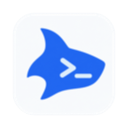
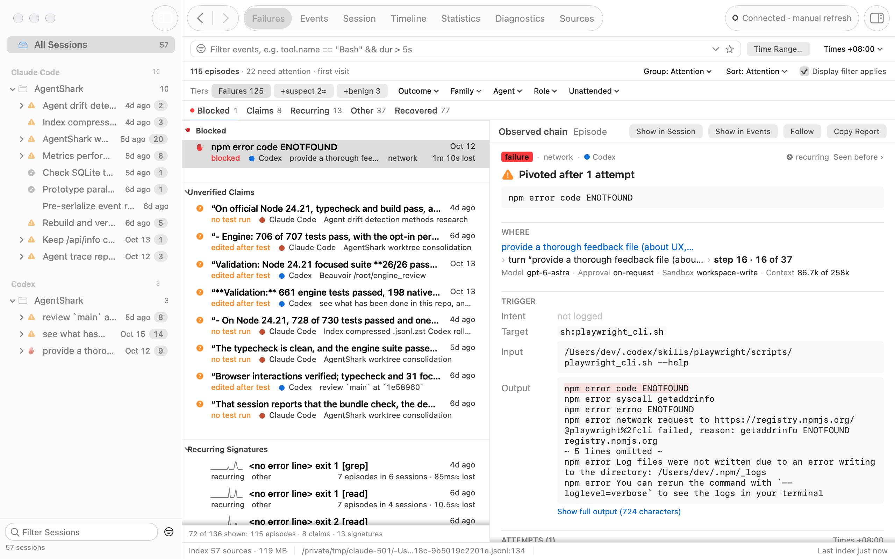
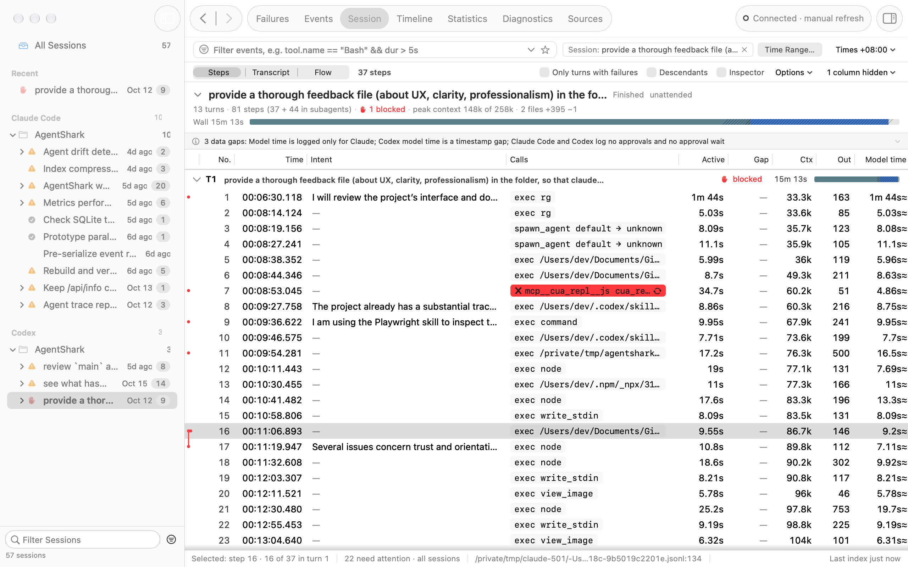
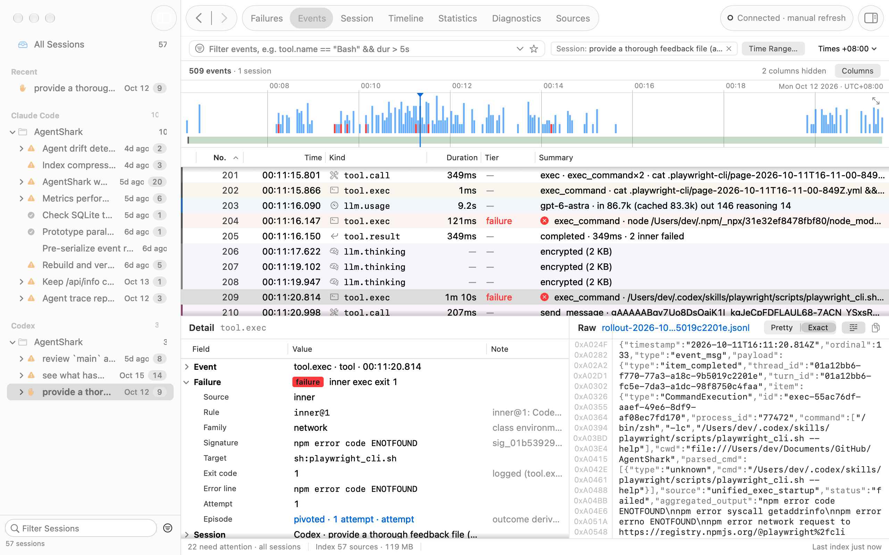
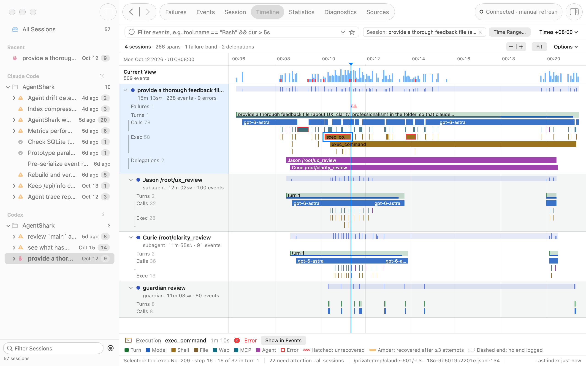
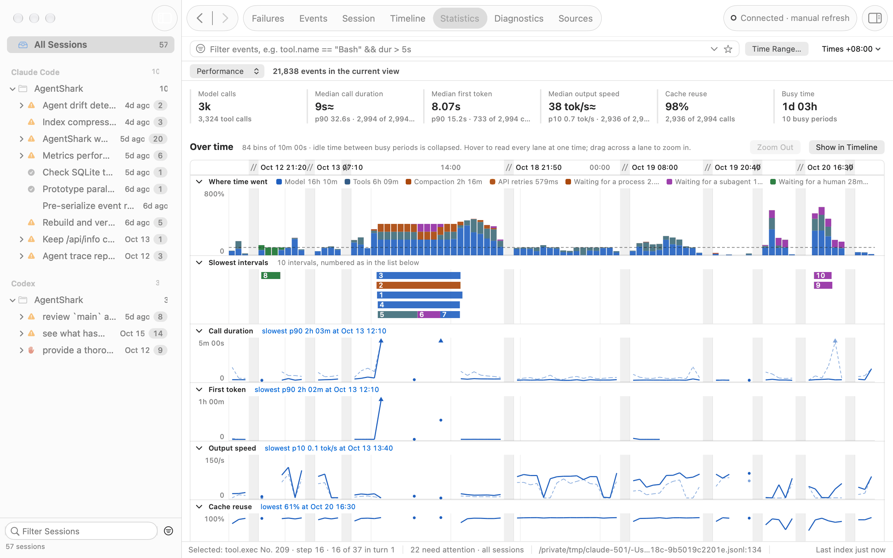
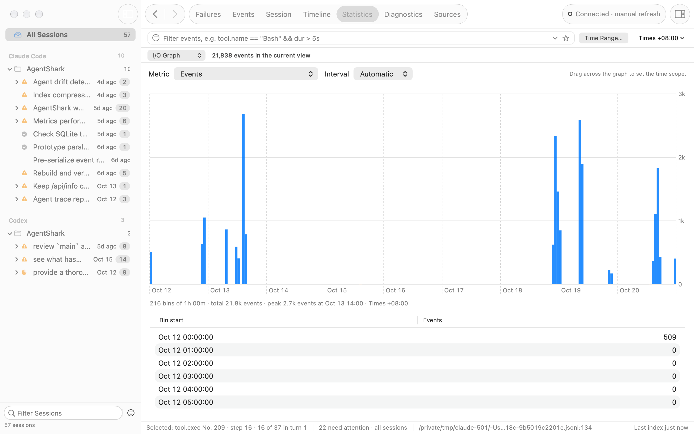

<p align="center">
  
</p>

<h1 align="center">AgentShark</h1>

<p align="center">
  <strong>Find out what your coding agent did, and why the run failed.</strong><br>
  A local, Wireshark-style inspector for Claude Code, Codex, Claude Cowork and GitHub Copilot Chat logs.
</p>

<p align="center">
  <a href="#quick-start">Quick Start</a> ·
  <a href="#supported-agents">Supported Agents</a> ·
  <a href="#a-tour-of-the-viewer">Tour</a> ·
  <a href="#mcp-server-for-agents">MCP</a> ·
  <a href="#privacy-and-safety">Privacy</a> ·
  <a href="#documentation">Docs</a>
</p>

<p align="center">
  
  
  
</p>

<picture>
  <source media="(prefers-color-scheme: dark)" srcset="docs/images/failures-dark.png">
  
</picture>
<p align="center"><sub>The macOS app on real Claude Code and Codex sessions from AgentShark's own development, with the home folder pseudonymized.</sub></p>

Coding agents already write a detailed record of every prompt, model step, tool call and error to your disk. Those records are hard to read: one session can span thousands of JSON lines across several subagents, and each agent writes its own format. AgentShark reads the files where they are, indexes them into one local SQLite database, and takes you from "this run failed" to the exact source line that shows why.

The interface follows Wireshark: an overview of sessions, a filterable event list, a decoded detail tree and the raw record behind it. The resemblance ends there, and AgentShark does not read or write pcap files.

Everything runs locally. AgentShark needs no account, API key or agent plugin, it never modifies the logs it reads, and it sends no data off your machine.

## Why AgentShark

- **Failures come first.** An attention queue groups failures into episodes (repeated attempts at one command or file within a turn) and ranks them: blocked by the sandbox, a policy or the network; never recovered; subagents that failed without telling their parent; and claims such as "all tests pass" that no passing test in the logs backs up.
- **It shows evidence and names no cause.** Each derived value is marked as logged, derived (≈), parsed (~) or inferred by a named rule (?). Missing data appears as a stated gap, never as a zero. AgentShark runs no model.
- **Every field leads back to its bytes.** The decoded detail tree sits beside the original source record, so you can check any conclusion against the log itself.
- **Your agent can ask too.** A read-only MCP server lets Claude Code or Codex diagnose its own runs, with home paths and secrets redacted.
- **Evidence you can keep.** A capture file outlives the agents' own log cleanup, and a shareable profile strips free text and pseudonymizes paths.
- **Replay without a model.** Run a session's recorded tool calls again in a Docker container without network, and see where the results first diverge.

## Quick Start

You need [Node.js](https://nodejs.org/) 24.12 or newer. AgentShark has no runtime dependencies, and Node runs its TypeScript source directly, so a fresh checkout runs without `npm install`. Only building the `agentshark` command or the macOS app needs `npm ci` first.

### Install with One Prompt

Paste this line into Claude Code, Codex or another coding agent:

```text
Install AgentShark for me: clone https://github.com/naisslab/AgentShark, then follow docs/AGENT-INSTALL.md in the checkout.
```

The agent checks your Node.js version, builds and links the `agentshark` command, indexes your logs, registers the MCP server with itself, and reports what it did. It never uses `sudo`, and it stops to ask before installing Node.js or touching `/Applications`. [docs/AGENT-INSTALL.md](docs/AGENT-INSTALL.md) is the guide it follows, if you want to read the steps first.

### Try the Demo

```bash
git clone https://github.com/naisslab/AgentShark.git agentshark
cd agentshark
node bin/agentshark.ts demo
```

The demo indexes only the bundled synthetic traces into a temporary index and opens the viewer in your browser. It does not scan your home folder or change your saved settings, and it deletes its index when you press Ctrl+C. Three things to try:

1. The viewer opens on **Failures**. Select the first item under *Blocked by environment*; the Lens on the right shows the denied command, where it ran and how the turn ended.
2. Click **Show in Session** to see the run as turns and steps with the failed call marked. Select the call, then expand **Raw source line** in the inspector to see the record behind the decoded fields.
3. Click **Workbench** in the toolbar to open the analysis tools. Choose **Replay Plan** and the session *Fix the failing test* to see which recorded calls `agentshark replay` would run again, including those inside a Codex code-mode script.

### Inspect Your Own Logs

```bash
node bin/agentshark.ts serve
```

`serve` finds the logs of every supported agent on this machine, indexes them and opens the viewer. It prints a URL such as `http://127.0.0.1:7373/?token=…`. The token is required, and it changes each time the server restarts. Press Ctrl+C to stop.

The first index works newest first. Sessions being written right now appear within about a second, the last day's within a few seconds, and older history fills in behind them. On one machine with about 4 GB of transcripts (2,000 files), the whole first index took 35 to 40 seconds; on another with about 12 GB (5,900 files), it took about 3.5 minutes. Afterwards AgentShark watches the files and parses again only the ones that change.

To type `agentshark` instead of `node bin/agentshark.ts`, build and link the package. `npm ci` installs TypeScript, which the build uses.

```bash
npm ci
npm run build
npm link
```

The rest of this README uses the short form.

<details>
<summary><strong>First Run and Data Locations</strong></summary>

1. **Discovery.** AgentShark lists the log files of every supported agent (see [Supported Agents](#supported-agents)).
2. **Indexing.** Up to eight worker threads parse the files into `~/.agentshark/index.sqlite`, newest first. The status reads "Indexing n/m · since <time>" until history is complete.
3. **Watching.** The server checks the files every 3 seconds and indexes again at most once every 5 seconds while an agent keeps writing. Start with `--no-watch` to index once; the viewer then shows "Connected · manual refresh", and **Re-index Now** in that status menu (or a restart) refreshes it.

The index is a cache of your logs, and it can approach their size: on the 12 GB machine above it reached about 10 GB, and the first index used about 5 GB of memory at its peak. Deleting it is safe, because the next run builds it again. Set `AGENTSHARK_HOME` to keep it in another folder, or pass `--index PATH` to a single command. Opened captures are cached in `~/.agentshark/captures/`. AgentShark refuses to open a database that is not an AgentShark index and leaves such a file untouched.

Stopping `serve` also stops an index run in progress; files it had not committed are parsed again next time. If your agents keep their data in a custom location, add it with `agentshark config --agent claude --add PATH` (or `--agent codex`), or in the macOS app under Settings ▸ Sources.

</details>

## Install

| Option | Status | Steps |
|---|---|---|
| Your coding agent | Available | The one-line prompt in [Install with One Prompt](#install-with-one-prompt) |
| CLI and browser viewer from source | Available | `npm ci`, `npm run build`, `npm link` (above) |
| macOS app | Build it yourself; no signed public release yet | `npm ci`, then `npm run desktop:build`, which writes `dist/AgentShark.app` |
| npm package | Not yet published | `npm ci` and `npm pack` in a checkout, then `npm install -g ./agentshark-0.1.0.tgz` |

The macOS app (macOS 15 or later) bundles the engine and its own Node runtime, so the person using it needs no terminal, Node or agent configuration. It discovers and watches local Claude and Codex logs when it opens, and its Analyze menu opens Critical Path and Compare Runs, the bundled demo, and the other analysis tools in the browser.

Building the app needs a Swift toolchain, and the result carries an ad hoc signature for local testing only. If the checkout sits in an iCloud-synced Desktop or Documents folder, set `APP_OUTPUT` to a path outside it; [docs/RELEASE.md](docs/RELEASE.md) explains why.

Linux and Windows have no native app; use the CLI and the browser viewer. Windows support is partial: the maintainers run the full test suite on Linux and macOS, but only type checking and the installed-package checks on Windows. [docs/INSTALL.md](docs/INSTALL.md) covers source configuration, upgrades, uninstalling and troubleshooting, and [docs/RELEASE.md](docs/RELEASE.md) covers the app build's options and how to check the result.

## Supported Agents

| Source | Status | What is read |
|---|---|---|
| Claude Code transcripts (`~/.claude/projects`), CLI and desktop Code tab | Fully parsed | Every record type; subagents, workflows, persisted outputs, file history |
| Claude Cowork transcripts and `audit.jsonl` | Fully parsed | Transcripts as above; the audit log adds turn timing, time to first token, cost, permissions and retries |
| Claude desktop registries (`local_*.json`) | Metadata only | Titles, models, permission mode, worktrees and pull requests; sessions whose transcripts were deleted |
| Codex rollouts (`~/.codex/sessions`, `archived_sessions`): CLI, Desktop, exec, VS Code | Fully parsed | Every envelope and legacy record type; continuation pages, child threads, zstd-compressed (`.jsonl.zst`) rollouts |
| Codex `state_5.sqlite` | Metadata only | Titles, archive state, spawn edges |
| GitHub Copilot Chat in VS Code (`chatSessions/*.json`) | Partially parsed | Prompts, responses, request timing and tool calls (which carry no timing of their own); edits are not decoded |
| Google Antigravity, ChatGPT desktop, Copilot CLI, Gemini CLI, Cursor, Windsurf, Ollama, opencode | Detected, not parsed | `agentshark sources` reports that the agent is installed and why its logs cannot be read |

AgentShark keeps records it does not understand as `raw.unknown` events with their full source line, so nothing is dropped silently; keeping a record is not the same as decoding it. `agentshark sources` (the Sources workspace in the viewer) measures which capabilities the logs on this machine actually provide for each agent: timestamps, latencies, exit codes, token usage, reasoning text and more.

## A Tour of the Viewer

The viewer opens on **Failures** when an alarm fires (for example, a run that loops, stalls or is blocked) or new items need attention since your last visit; otherwise it reopens where you left off. Alt+1 to Alt+7 switch between the seven workspaces.

| Workspace | What it shows |
|---|---|
| **Failures** | The attention queue, and the Lens: the observed chain of the selected failure, each attempt with the edits between attempts, how it closed, and whether earlier sessions hit the same error and what got past it |
| **Events** | A filterable list of every event, the decoded detail tree and the raw source record |
| **Session** | One run as Steps (turns, model steps, tool calls and a run report), as a Transcript or as a Flow diagram |
| **Timeline** | Sessions, subagents, tool calls, background processes and failure bands on one time axis |
| **Statistics** | Summary, tools, models and turns; Performance shows where time went, and the I/O graph plots any metric over time |
| **Diagnostics** | Like Wireshark's Expert Information: tool and API errors, retries, refusals, denied permissions, unpaired calls and unparseable records, grouped by severity and linked to their events |
| **Sources** | Per-agent logging health: what the logs on this machine record and what they lack |

The screenshots below show the macOS app; the browser viewer has the same workspaces and the same numbers.

**Session ▸ Steps** lays out one run as turns and model steps. Each turn shows its outcome, failed calls are marked in red, and the header strip splits wall time into waiting, tools, model and time that no log accounts for.

<picture>
  <source media="(prefers-color-scheme: dark)" srcset="docs/images/session-dark.png">
  
</picture>

**Events** works like Wireshark's packet list. A strip above the list shows when events happened, the Detail pane decodes the selected event, and the Raw pane shows the source record with its byte offsets.

<picture>
  <source media="(prefers-color-scheme: dark)" srcset="docs/images/events-dark.png">
  
</picture>

**Timeline** puts a run and its subagents on one axis, with lanes for turns, model calls, shell commands, delegations and failures.

<picture>
  <source media="(prefers-color-scheme: dark)" srcset="docs/images/timeline-dark.png">
  
</picture>

**Statistics ▸ Performance** starts with headline figures (model calls, median call duration, first token, output speed, cache reuse and busy time), then puts lanes on one time axis: where time went (model, tools, compaction, API retries, and waiting for a process, a subagent or a human), the slowest intervals, call duration, first token, output speed and cache reuse. Idle time between busy periods collapses, one cursor reads every lane, and dragging across a lane zooms in.

<picture>
  <source media="(prefers-color-scheme: dark)" srcset="docs/images/performance-dark.png">
  
</picture>

**Statistics ▸ I/O Graph** plots one metric per interval, as Wireshark's I/O graph does: events, errors, input or output tokens, tool or model calls, model latency, time to first token, output speed, context size or failures. Dragging across the graph sets the time scope, and the bins copy as CSV.

<picture>
  <source media="(prefers-color-scheme: dark)" srcset="docs/images/io-graph-dark.png">
  
</picture>

A few keys move through an investigation quickly: `e` and `E` jump to the next or previous failure, `u` to the next attention item, and Shift+Enter shows the selection in its session step. `f` follows one tool call, subagent, background process or file as a stream, and `c` opens a redacted report to copy into an issue or hand to a fresh agent.

## Diagnose from the Terminal

The analysis behind the Failures workspace also answers on the command line:

```bash
agentshark why                       # the latest finished run: what failed and what needs attention
agentshark failures --since 7d       # failure episodes that need attention
agentshark sig "Error: Cannot find module 'left-pad'"   # have agents hit this error before, and what got past it?
```

`why` prints a run report in Markdown, ready for an issue or a pull request. This excerpt comes from the demo's Claude Code run, with IDs shortened and some lines left out:

```text
# Run report: Run the tests

claude-code · finished · unattended · 2026-10-11T09:00:00Z to 2026-10-11T09:30:30Z

**Turns** 16 (human 15 · task-notification 1) · **Steps** 53, 14 with a failure
**Impact** failed 4 · blocked 1 · interrupted 1 · masked 2 · degraded 2 · recovered 4 · clean 2

## Needs attention

- **blocked** episode `…:24`: PreToolUse:Bash hook error: [<path>]: Blocked: rm -rf is not allowed in this repo on `sh:rm` (pivoted), 1 attempts
- **unrecovered** episode `…:92`: tests failed on `sh:pytest` (ended-on-failure), 2 attempts
- **silent-child** delegation `…toolu_m19`: check docs (failed)
- **unverified-claims** claim `…p89`: “All tests pass.” (last-test-failed)
- **unverified-claims** claim `…p75`: “The build succeeds.” (edited-after-last-test)
```

Add `--json` to `why`, `failures` or `sig` for the same JSON the MCP server returns. `why` prints the run's session ID on its first line (`Run cc:22222222-…`); commands that take `--session ID` or a `SESSION` argument accept that ID or a unique prefix of it.

### Display Filters

The viewer's filter bar and `agentshark list -f` take Wireshark-style expressions over agent fields:

```text
error                                   events flagged as failures
tool.name == "Bash" && dur > 2s         slow shell calls (bare numbers are milliseconds for durations)
agent == codex && kind == "tool.call"   one agent's tool calls
"npm test"                              full-text phrase: the words next to each other
"npm" && "test"                         both words anywhere
ts >= "2026-10-11 09:00"                local time
ts >= "2026-10-11T09:00Z"               UTC; "2026-10-11T09:00+08:00" names any other zone
ts > -2h                                relative to now
```

`agentshark list` prints the matching events like `tshark`:

```text
$ agentshark list -f 'tool.name == "Bash" && dur > 2s' -n 5
No.  Time                                    Δ  Session            Kind                 Duration  Summary
  1  2026-10-11 17:00:04.000 +08:00      0.000  cc:22222222        tool.call                  5s  Bash  pytest -q
  2  2026-10-11 17:00:09.000 +08:00      5.000  cc:22222222        tool.result                5s  exit 1 · 58 B · 5s · Exit code 1 ..F.F ===== 2 failed, 41 passed in 3.21s =====
  3  2026-10-11 17:00:18.000 +08:00      9.000  cc:22222222        tool.call                  4s  Bash  pytest -q
  4  2026-10-11 17:00:22.000 +08:00      4.000  cc:22222222        tool.result                4s  ok · 18 B · 4s
  5  2026-10-11 17:02:42.000 +08:00    140.000  cc:22222222        tool.call                  4s  Bash  pytest -q
showing 5 of 30 events; use --limit 0 for all
```

Run `agentshark fields` for every filter field. Times without a zone are local time everywhere: in filters, in `--since` and `--until`, and in the HTTP API. Printed times always show their UTC offset, and `agentshark list --utc` prints UTC.

## MCP Server for Agents

`agentshark mcp` lets a coding agent query the index about its own runs. It offers nine tools: `find_runs`, `run_report`, `list_failures`, `get_episode`, `lookup_error`, `watch`, `query`, `get_event` and `analyze_trace`. The server speaks JSON-RPC over stdin and stdout, opens the index read-only, writes nothing and opens no socket. It never indexes, so keep `agentshark serve` running (or run `agentshark index`) for fresh data.

AgentShark never edits agent configuration; register the server yourself. These lines assume `agentshark` is on your PATH; otherwise use `node /path/to/agentshark/bin/agentshark.ts mcp`.

```bash
claude mcp add agentshark -- agentshark mcp
```

For Claude Code, add `--scope user` after `mcp add` to register it for every project. For Codex, add this to `~/.codex/config.toml`:

```toml
[mcp_servers.agentshark]
command = "agentshark"
args = ["mcp"]
```

`agentshark sources` prints these registration lines for the agents it finds.

<details>
<summary><strong>What the MCP Server Shows an Agent</strong></summary>

- **Scope.** Only runs whose working directory is under the agent's git root (from the client's MCP roots, else the server's working directory). Register with `agentshark mcp --scope all` to see every project.
- **Redaction.** Your home folder becomes `~`, your user name `<user>`, and secret-shaped strings (`sk-`, `ghp_`, `github_pat_`, Slack `xox?-`, `AKIA`, `Bearer` tokens, JWTs, PEM blocks) become `<secret:class:length>`.
- **Untrusted text.** Text from the logs appears only in fields whose names end in `_excerpt`, cut to 300 characters (output heads and tails to `output_chars` or `max_chars`). The tool descriptions tell the agent to treat that text as data, never as instructions.
- **Size.** Each result stays under `--max-bytes` (default 16,384) and lists in `cut` what it left out. Every result also carries `index_age_s`, `indexer`, `analysis_version` and `gaps` (the data the logs do not contain).
- **Raw records.** `get_event` includes the native source record only when the server runs with `--allow-raw`.

</details>

## Keep and Share Evidence with Captures

Agents delete or rotate their own logs. `agentshark capture -o FILE.agentcap.zst --since 7d` writes the selected sessions to one self-contained file, and `agentshark open FILE` views it later in the same viewer.

A default **forensic** capture keeps private evidence: prompts, assistant and thinking text, tool inputs and outputs, file paths, the original source lines and side files. `--no-raw` makes a capture smaller but is not redaction. To share a trace, use the **shareable** profile, which removes free text, raw records and side files and pseudonymizes identifiers and paths while keeping measurements and relationships:

```bash
agentshark capture --profile shareable --preview --session ID
```

<details>
<summary><strong>Capture Contents and Integrity</strong></summary>

A forensic capture contains:

- the normalized records: prompts, assistant and thinking text, tool inputs and outputs (text fields capped at about 4 KB), token counts, timings, diagnostics, file paths, working directories and git branches, plus a compact copy of each source record;
- the original source lines, unless `--no-raw`;
- side files (persisted tool outputs, subagent and workflow metadata), unless `--no-sidecars`;
- the host name, platform and the selection in its header.

Every capture records what it could not include (raw lines of files deleted since indexing, side files that were missing or too large), and `open` reports this, and whether the file was cut short, every time it opens the capture. A secret `--redaction-key-file` keeps pseudonyms stable across shareable exports without saving that key in the capture.

Captures record a consistent index snapshot, rule versions, thresholds, a fixed analysis clock and integrity checks. `agentshark open FILE --analysis current` re-analyzes with current rules; the default uses the recorded settings. `--integrity recover` opens damaged evidence with an integrity warning. [docs/CAPTURES.md](docs/CAPTURES.md) and [docs/FORMAT.md](docs/FORMAT.md) have the details.

</details>

## Replay a Session

`agentshark replay` runs a session's recorded tool calls again inside a Docker container and compares each new result with the recorded one. It calls no model: every call is issued exactly as logged, at the recorded pace or a scaled one. It needs Docker, which pulls the container image on first use.

```bash
agentshark replay SESSION --dry-run                          # the plan: what would run, what is skipped and why
agentshark replay SESSION --workspace ~/src/app --rev abc123 --speed max
```

Shell commands (Claude `Bash`; Codex `exec_command`, `shell_command`, `shell`) and file tools (`Read`, `Write`, `Edit`, `MultiEdit`, `apply_patch`) run again. Search, web, MCP, planning and subagent-management tools are skipped, as are calls the user rejected. The container starts from `--image` (default `node:24-bookworm`) with no network unless `--network` names one, and nothing on the host is mounted. Each call gets a verdict (`same`, `output` or `status`); the first `status` difference is where the replay diverged, and the command exits with 3 when any status differed. The trace does not contain the files the session started from, so the result depends on the workspace you supply. [docs/REPLAY.md](docs/REPLAY.md) lists what a replay cannot reproduce.

## Workbench for Engineers and Researchers

Open **Workbench** from the viewer's toolbar, or in the macOS app with **Analyze** ▸ **Open Research Tools in Browser**. The macOS app also shows Critical Path and Compare Runs natively, as the Session modes Critical Path (⌥⌘4) and Compare (⌥⌘5) of the run selected in the sidebar. The same analyses run through `agentshark analyze` and the MCP tool `analyze_trace`. Each tool states the limit of its evidence:

| Tool | Question it answers | Evidence limit |
|---|---|---|
| Critical Path (AgentPerf) | Which class of time takes the largest share of the run's critical path: model, tools, people or other agents? | Queueing and approval waits are not logged; the path follows only recorded waits. |
| Cache Anatomy | Where did the prompt cache break, and why? | Codex logs no miss reason, so its causes come from surrounding events. |
| Span Dependencies | Where was measured time spent? | Only observed dependencies contribute to the dependency graph. |
| Context Inspector | Which instructions, outputs and compaction records precede an action? | Reconstructed context does not establish exact model inputs. |
| Change and Verification | Which checks occurred after an edit? | Chronology does not establish file-level test coverage. |
| Localization Map | How quickly did a run find the files it changed, and which edits had no read of the current version? | Shell reads and writes are partly invisible; localization describes the search, not the edits. |
| Capability Envelope | What was the run allowed to do, and what did it use? | Approvals are not logged; network use is read from command text. |
| Compare Runs (AgentDiff) | Where do two runs of one task part, and how did each answer failures? | The first divergence is a lead for investigation, not a cause. |
| Compare Records | Where do two sessions' records differ, aligned by event kind and tool name? | Repeated actions can make alignment ambiguous. |
| Sequence Search | Where does an ordered or repeated pattern occur? | Only the examined event window is searched. |
| Behavioral Checks | Do recorded actions satisfy explicit rules? | Results are pass, fail or unknown; a pass does not establish task success. |
| Agent Coordination | Which agents touched the same files or have unresolved delegations? | Overlap and stale reads are review candidates. |
| Dataset Builder | Which failure examples have reviewed labels and provenance? | Split grouping and redaction require review before publication. |
| Research Cohorts | How do labeled tasks, trials and conditions compare? | Descriptive comparisons do not establish causal effects. |
| Replay Plan | Which recorded calls would a replay run again, and which can it not reproduce? | The trace holds no starting files; the result depends on the workspace you supply. |
| Replay Report | Where did a replay of the recorded actions diverge? | A status difference names no cause; later calls ran in an unrecorded state. |

You can save recipes, import manifests and human labels, export CSV and JSONL, and package investigations locally. `agentshark check` runs behavioral checks in CI and exits with pass, fail, invalid or unknown. [docs/WORKBENCH.md](docs/WORKBENCH.md) documents requests, schemas, confidence levels and exit codes, and [docs/INTEROP.md](docs/INTEROP.md) covers offline OTLP and OpenInference conversion.

## Privacy and Safety

Agent logs contain source code, prompts and sometimes credentials, so AgentShark treats them carefully:

- It reads agent logs and never modifies them. It never reads credential files (`~/.codex/auth.json`, `*.key`, `.audit-key`, cookies, browser storage).
- The viewer binds to `127.0.0.1` and requires a token that changes with every server start.
- The MCP server is read-only, limited to the agent's own project by default, and redacts home paths, your user name and secret-shaped strings.
- A default capture contains private text. Only the shareable profile removes it, and even then, review a capture before you share it.

Report security problems privately as described in [SECURITY.md](SECURITY.md), never with a real trace in a public issue.

## Command Reference

```text
agentshark serve [--port 7373] [--no-open] [--no-watch]      start the viewer on the live index
agentshark demo                                              open bundled synthetic traces
agentshark open FILE.agentcap[.zst|.gz]                      view a capture
agentshark why [--last|--session ID|--cwd DIR] [--since 8h]  why a run failed: its run report (--json, --md)
agentshark failures [--since 7d] [--signatures] [--json]     failure episodes that need attention
agentshark sig "<error text>"                                have agents hit this error before, and what got past it
agentshark list [-f FILTER] [--session ID] [--utc] [--json]  print events
agentshark stats [--view summary|tools|models|kinds|pairs]   print statistics
agentshark fields                                            filter fields
agentshark sources [--json]                                  logging health
agentshark index [--full|--rederive] [--agent cc|cw|cx|cp]   build or update the index; --rederive recomputes the analysis only
agentshark config [--agent codex|claude] [--add PATH]        configure additional source folders
agentshark capture -o FILE [--since 7d] [--session ID]...    write a capture
agentshark replay SESSION --workspace DIR [--speed N|max]    re-run a session's tool calls in a Docker container
agentshark mcp [--scope project|all] [--max-bytes 16384]     read-only MCP server for agents (stdio)
agentshark analyze OPERATION [--session ID] [--input FILE]   run Workbench analysis or export
agentshark check [--session ID] [--input FILE]               CI checks: pass, fail, invalid or unknown
agentshark telemetry import|export [--input FILE]            offline OTLP/OpenInference conversion
```

`agentshark <command> --help` describes each command's options.

## Documentation

| Document | Covers |
|---|---|
| [INSTALL.md](docs/INSTALL.md), [RELEASE.md](docs/RELEASE.md) | Installation, source configuration, troubleshooting, the app build and its bundled runtime |
| [WORKBENCH.md](docs/WORKBENCH.md), [INTEROP.md](docs/INTEROP.md) | Analyses, research workflows, CI checks and offline telemetry conversion |
| [CAPTURES.md](docs/CAPTURES.md), [FORMAT.md](docs/FORMAT.md) | Capture integrity, recorded analysis, redacted sharing and the `.agentcap` format |
| [REPLAY.md](docs/REPLAY.md) | `agentshark replay` and what it cannot reproduce |
| [ADAPTERS.md](docs/ADAPTERS.md) | The contract for contributors who add a trace source |
| [AGENT-INSTALL.md](docs/AGENT-INSTALL.md) | The steps a coding agent follows to install AgentShark for you |

## Project Status

AgentShark is at version 0.1.0 and has not had a public release. There is no signed and notarized macOS build and no published npm package yet, so the paths above build from source. A hand audit of about 1,100 sampled findings from one index found six inferred rules below the 0.8 precision that AgentShark requires of a shipped label. Recall has not been measured, and no reviewed held-out trace set exists yet, so treat heuristic findings as advisory. [CHANGELOG.md](CHANGELOG.md) lists what has changed.

## Contributing

The test suites are not in this repository yet. Build a change with `npm ci` and `npm run build`, try it with `node bin/agentshark.ts demo` and on your own logs, and say in the pull request what you tested.

The macOS client builds with Swift Package Manager. Use only synthetic or explicitly consented, redacted fixtures, and never submit private agent logs or index databases. [CONTRIBUTING.md](CONTRIBUTING.md) covers adding an adapter, the data a contribution may include and measuring performance on an official Node build.

## License

[MIT](LICENSE). The macOS app bundles an official Node.js runtime under its own license; see [NOTICE](NOTICE).
