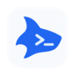
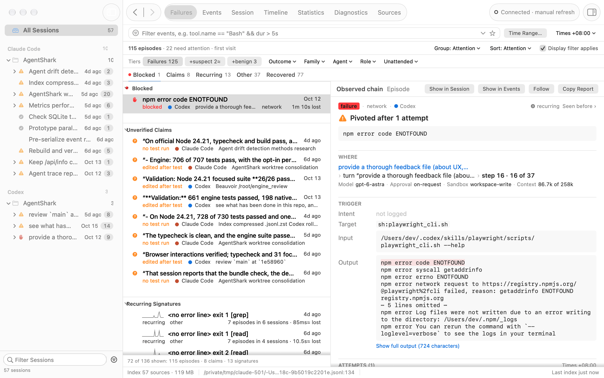
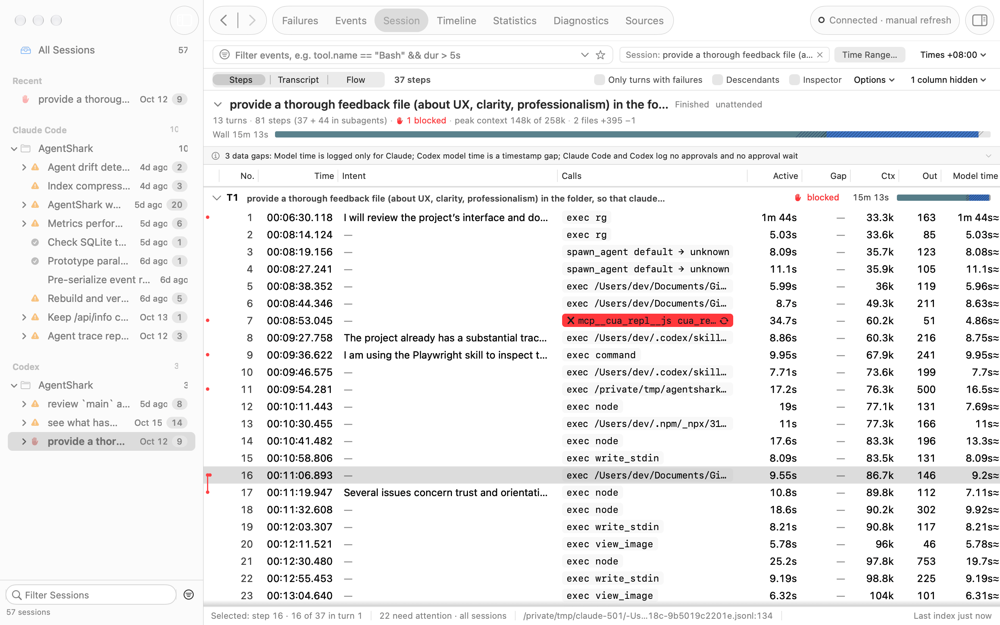
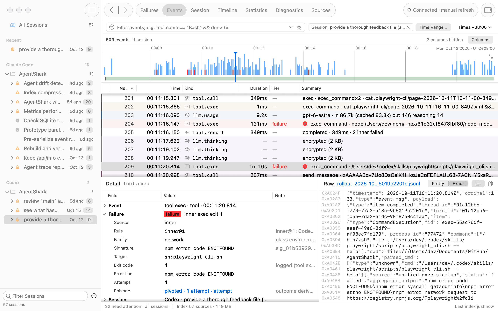
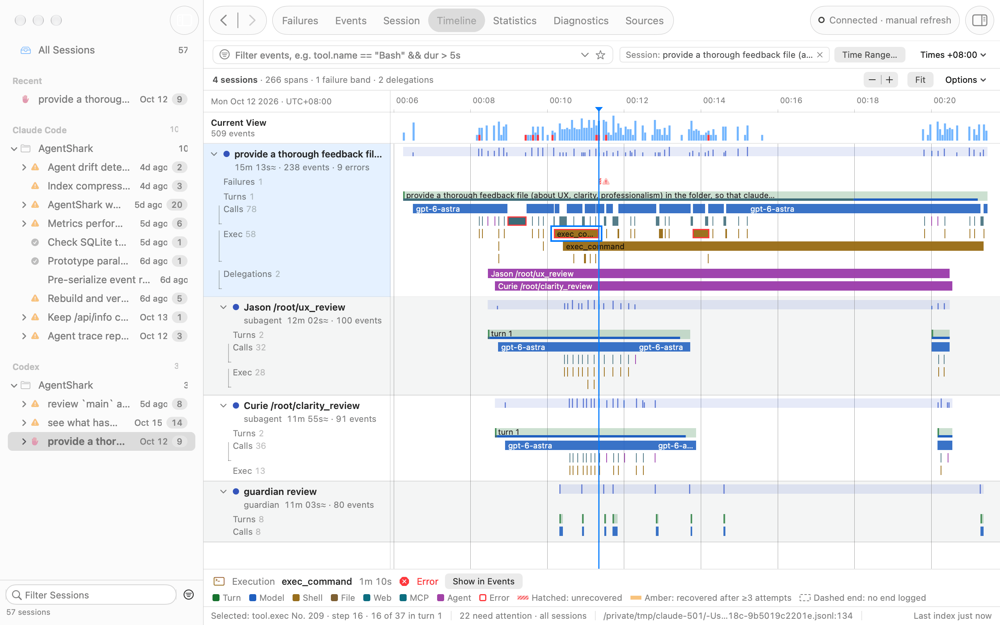
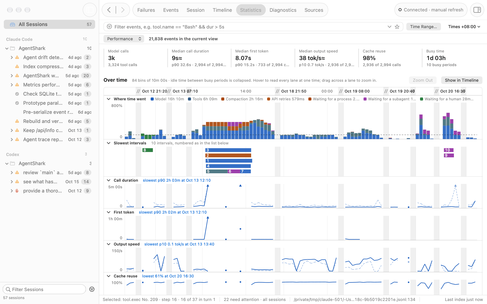
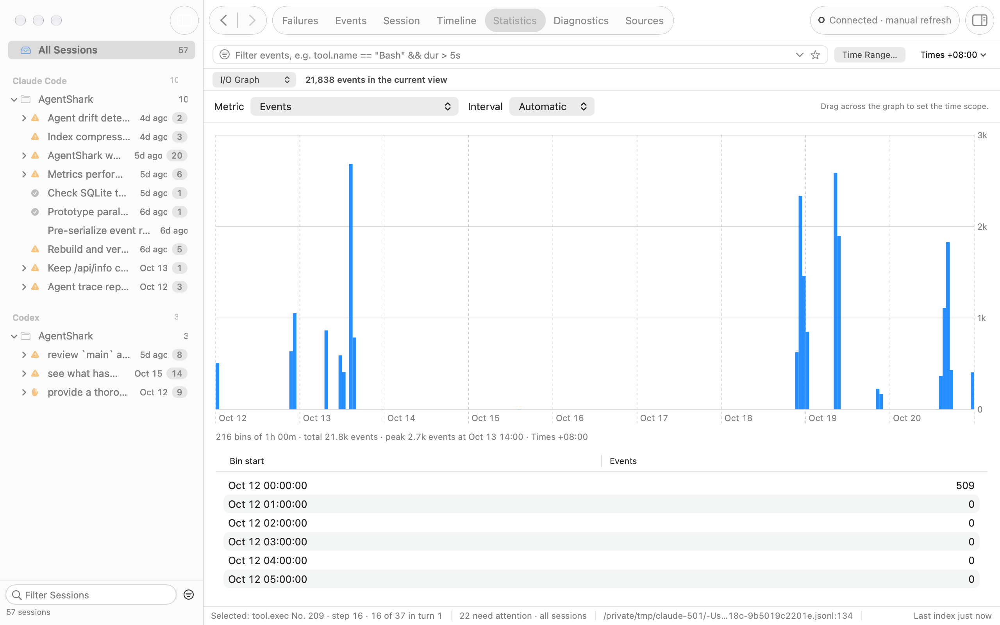

<p align="center">
  
</p>

<h1 align="center">AgentShark</h1>

<p align="center">
  <strong>Find out what your coding agent did, and why the run failed.</strong><br>
  A local, Wireshark-style inspector for agent traces.
</p>

<p align="center">
  <a href="#quick-start">Quick Start</a> ·
  <a href="#supported-agents">Supported Agents</a> ·
  <a href="#a-tour-of-the-viewer">Tour</a> ·
  <a href="#mcp-server-for-agents">MCP</a> ·
  <a href="#privacy-and-safety">Privacy</a> ·
  <a href="#documentation">Docs</a>
</p>

<p align="center">
  
  
  
</p>

<picture>
  <source media="(prefers-color-scheme: dark)" srcset="docs/images/failures-dark.png">
  
</picture>
<p align="center"><sub>The macOS app on real Claude Code and Codex sessions from AgentShark's own development, with the home folder pseudonymized.</sub></p>

Coding agents write detailed logs of every prompt, model step, tool call, and error to disk—often thousands of lines across subagents in incompatible formats. AgentShark indexes those local files into SQLite and takes you from a failed run to the exact source record that shows why, using a Wireshark-style event list, decoded detail tree, and raw record view. Everything runs locally with no account, API key, or network calls.

## Why AgentShark

- **Failures come first.** Groups repeated attempts into episodes and ranks blocked actions, unrecovered errors, silent subagent failures, and unbacked "all tests pass" claims.
- **Evidence, not guesswork.** Marks every value as logged, derived (`≈`), parsed (`~`), or rule-inferred (`?`). Missing data is shown as an explicit gap, never as zero, and no LLM is called.
- **Every field traces to raw bytes.** Inspect decoded fields right beside the original source line or database row.
- **Agent self-diagnosis (MCP).** A read-only MCP server lets Claude Code or Codex inspect its own past runs with home paths and secrets redacted.
- **Captures & resource recording.** Save self-contained `.agentcap.zst` bundles (optionally with 10 Hz process-tree CPU, RAM, disk, GPU, and network metrics) and redact before sharing.
- **Emulator-style replay.** Re-run recorded tool calls in an isolated offline Docker container with breakpoints, single-stepping, and save states.

## Quick Start

Requires [Node.js](https://nodejs.org/) ≥ 24.12 and Git. The native macOS app also requires macOS 15+ and Swift (`xcode-select --install`).

### Install with One Prompt

Paste into Claude Code, Codex, or another coding agent ([docs/AGENT-INSTALL.md](docs/AGENT-INSTALL.md)):

```text
Install AgentShark for me: clone https://github.com/naisslab/AgentShark, then follow docs/AGENT-INSTALL.md. On macOS, build, verify and open the native app; on other platforms, set up the web viewer. Also register and check the MCP server for this coding agent.
```

### macOS App

```bash
git clone https://github.com/naisslab/AgentShark.git ~/agentshark
cd ~/agentshark
npm ci
npm run desktop:build
open dist/AgentShark.app
```

The app discovers and indexes your local agent logs in the background (or choose **Analyze ▸ Explore Bundled Demo** for synthetic traces). Keep the checkout outside iCloud Drive, or set `APP_OUTPUT` to an unsynced folder ([docs/RELEASE.md](docs/RELEASE.md)).

### Web Viewer & CLI

Run directly from source without `npm install`:

```bash
node bin/agentshark.ts demo    # open browser on synthetic traces (cleans up on Ctrl+C)
node bin/agentshark.ts serve   # index local logs and print an authenticated 127.0.0.1 URL
```

To add `agentshark` to your `PATH`, run `npm ci && npm run build && npm link` ([docs/INSTALL.md](docs/INSTALL.md)).

## Supported Agents

| Source | Status | What is read |
|---|---|---|
| Claude Code (`~/.claude/projects`), CLI & desktop Code tab | Fully parsed | Every record type; subagents, workflows, persisted outputs, file history |
| Claude Cowork transcripts & `audit.jsonl` | Fully parsed | Transcripts plus turn timing, TTFT, cost, permissions, and retries |
| Claude desktop registries (`local_*.json`) | Metadata only | Titles, models, permission mode, worktrees, PRs, and deleted transcripts |
| Codex rollouts (`~/.codex/sessions`, `archived_sessions`) & `state_5.sqlite` | Fully parsed | CLI, Desktop, exec, VS Code; `.jsonl.zst` rollouts, child threads, spawn edges |
| GitHub Copilot Chat (`chatSessions/*.json`, `*.jsonl`) & CLI (`~/.copilot/session-state`) | Partially parsed | Prompts, responses, reasoning, tool calls with timing/exit codes, permissions, subagents, and persisted token usage |
| Google Antigravity (`~/.gemini/antigravity/conversations/*.db`) | Partially parsed | Prompts, responses, thinking summaries, model latency/TTFT/tokens, timed tool calls, exit codes, permissions, and subagents (unencrypted `.db`) |
| ChatGPT desktop, Gemini CLI, Cursor, Windsurf, Ollama, opencode | Detected | `agentshark sources` reports installation and log availability |

Unknown JSON records are preserved as `raw.unknown` with their full source line; `agentshark sources` measures which fields each agent's logs provide on your machine ([docs/ADAPTERS.md](docs/ADAPTERS.md)).

## A Tour of the Viewer

Switch between the seven workspaces with `Alt+1`–`Alt+7` (`e`/`E` next/previous failure, `u` next attention item, `Shift+Enter` show in session, `f` follow stream, `c` copy redacted report):

| Workspace | What it shows |
|---|---|
| **Failures** | Attention queue and the Lens: failure chain, retries, edits between attempts, resolution, and prior matching errors |
| **Events** | Filterable event list, decoded detail tree, and raw source record |
| **Session** | Single run as Steps, Transcript, Flow, Critical Path, or Reliability; Compare aligns two runs |
| **Timeline** | Sessions, subagents, tool calls, background processes, and failure bands on one time axis |
| **Statistics** | Summary, tools, models, turns, Performance lanes, Session/Host Resources, and I/O Graph |
| **Diagnostics** | Wireshark-style Expert Information: errors, retries, refusals, denied permissions, unpaired calls, and malformed rows |
| **Sources** | Per-agent logging coverage and health on this machine |

**Session ▸ Steps** lays out turns and model steps, highlights failed calls in red, and splits wall time into waiting, tools, model, and unaccounted gaps.

<picture>
  <source media="(prefers-color-scheme: dark)" srcset="docs/images/session-dark.png">
  
</picture>

**Events** pairs a timeline strip and filterable packet list with the decoded Detail pane and byte-offset Raw record.

<picture>
  <source media="(prefers-color-scheme: dark)" srcset="docs/images/events-dark.png">
  
</picture>

**Timeline** aligns a run and its subagents across turns, model calls, shell commands, delegations, and failures.

<picture>
  <source media="(prefers-color-scheme: dark)" srcset="docs/images/timeline-dark.png">
  
</picture>

**Statistics ▸ Performance** summarizes call latency, TTFT, output speed, and cache reuse, with synchronized zoomable lanes and collapsed idle gaps.

<picture>
  <source media="(prefers-color-scheme: dark)" srcset="docs/images/performance-dark.png">
  
</picture>

**Statistics ▸ I/O Graph** plots events, errors, tokens, latency, or context size over time and exports bins as CSV.

<picture>
  <source media="(prefers-color-scheme: dark)" srcset="docs/images/io-graph-dark.png">
  
</picture>

## CLI, MCP, Captures, Replay & Workbench

- **Terminal triage ([docs/CLI.md](docs/CLI.md)):**
  ```bash
  agentshark why                                         # run report for the latest finished session
  agentshark failures --since 7d                         # failures needing attention
  agentshark sig "Error: Cannot find module 'left-pad'"  # matching failures across history
  ```
- <a id="mcp-server-for-agents"></a>**MCP Server ([docs/MCP.md](docs/MCP.md)):** Exposes read-only tools (`find_runs`, failure and step queries) scoped to the active project by default (`--scope all` for all projects). Keep the app or `agentshark serve` running, or run `agentshark index` before querying.
- **Captures & Resource Metrics ([docs/CAPTURES.md](docs/CAPTURES.md)):** Run `agentshark serve --record-resources` (or start recording in the app) for 10 Hz session process-tree CPU/RAM/disk/GPU/network metrics. Save traces with `agentshark capture -o run.agentcap.zst --since 7d`, preview redaction with `--profile shareable --preview`, and reopen with `agentshark open`.
- **Replay ([docs/REPLAY.md](docs/REPLAY.md)):** Preview with `agentshark replay SESSION --dry-run` or execute in offline Docker with `--workspace DIR`. Supports interactive stepping, container shell, `--break status`, and `--resume NAME`.
- **Workbench ([docs/WORKBENCH.md](docs/WORKBENCH.md)):** Native macOS modes for **Critical Path**, **Compare Runs**, and **Reliability Checks**, plus browser tools for context, edit verification, cache behavior, coordination, replay plans, and dataset export.

## Privacy and Safety

- **Read-only on logs:** Never modifies agent logs or reads credential files (`~/.codex/auth.json`, `*.key`, `.audit-key`, cookies, browser storage).
- **Local & authenticated:** Viewer binds to `127.0.0.1` with a per-launch token; MCP redacts home paths, usernames, and secret patterns.
- **Explicit sharing:** Default captures retain raw text; use `--profile shareable` and review before sharing. Report vulnerabilities via [SECURITY.md](SECURITY.md).

## Documentation

| Document | Covers |
|---|---|
| [INSTALL.md](docs/INSTALL.md), [RELEASE.md](docs/RELEASE.md), [AGENT-INSTALL.md](docs/AGENT-INSTALL.md) | Setup, source locations, macOS app build, and agent-driven install |
| [CLI.md](docs/CLI.md), [MCP.md](docs/MCP.md) | CLI commands, display filters, and MCP configuration |
| [WORKBENCH.md](docs/WORKBENCH.md), [INTEROP.md](docs/INTEROP.md) | Workbench analyses, CI checks, and OTLP/OpenInference conversion |
| [CAPTURES.md](docs/CAPTURES.md), [FORMAT.md](docs/FORMAT.md), [REPLAY.md](docs/REPLAY.md) | Resource recording, `.agentcap` format, redaction, and container replay |
| [ADAPTERS.md](docs/ADAPTERS.md), [CHANGELOG.md](CHANGELOG.md) | Adding trace adapters and release notes (v0.1.0; heuristic rules are advisory) |

## Contributing & License

The test suites are not in this repository yet. Build a change with `npm ci` and `npm run build`, try it with `node bin/agentshark.ts demo` and on your own logs, and say in the pull request what you tested.

The macOS client builds with Swift Package Manager. Submit only synthetic or redacted fixtures ([CONTRIBUTING.md](CONTRIBUTING.md)). Licensed under [MIT](LICENSE) ([NOTICE](NOTICE)).
